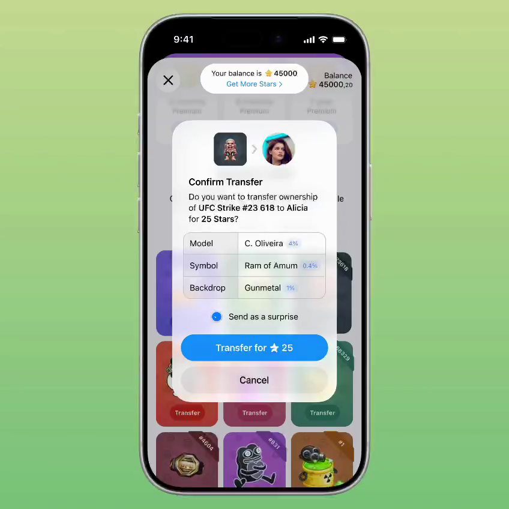
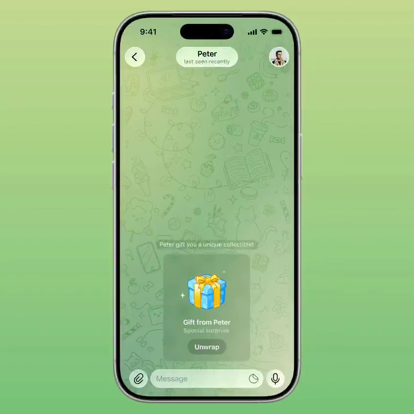
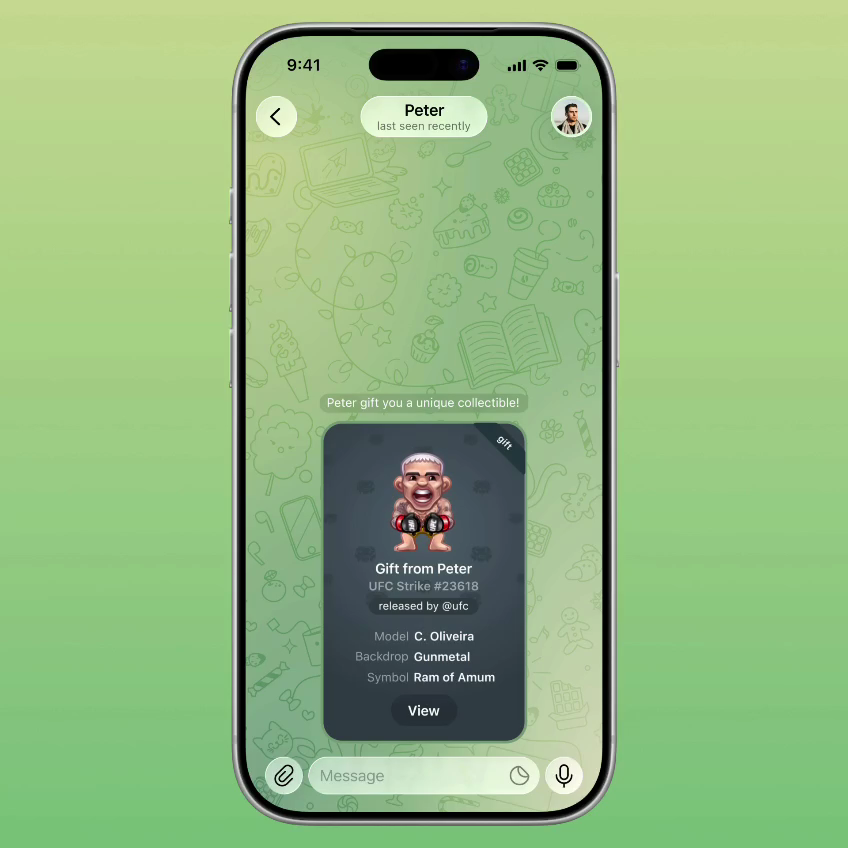

# Surprise Gifts for Telegram iOS

Give a collectible a moment of surprise. Send it wrapped, then unwrap it in the chat to reveal its model, backdrop, symbol and collectible number.

A native iOS concept built with Telegram's existing gift cards, collectible composition and attribute reels.

## Concept preview

| Send as a surprise | Wrapped in the chat | Collectible revealed |
| --- | --- | --- |
|  |  |  |

Selected frames from the supplied concept video (4.5 s, 7.0 s and 12.5 s), credited to **@IdeaAnimator** and **@azc0n**. These illustrate the original design reference, not screenshots of this implementation; the current demo uses the green-star sticker for the sealed gift.

## How it works

1. Choose a collectible in the marketplace and simulate purchasing it for its listed Stars or TON price.
2. Select a recipient and enable **Send as a surprise** in the transfer confirmation. The option is unchecked by default.
3. Confirm the simulated 25-Star transfer. A sealed gift appears in the selected chat with a green-star sticker and a translucent background.
4. Tap **Unwrap**. The model, backdrop, symbol and number cycle, then settle on the selected collectible with confetti. The selected model stays in the same composition through completion.
5. Tap **View** to open the gift details. With surprise disabled, the card starts opened. Reduce Motion skips the reveal animation.

## Contents

| File | Contents |
| --- | --- |
| `changes.patch` | Implementation and build integration against the pinned Telegram-iOS base |
| `BASE_COMMIT` | Full base revision |
| [IMPLEMENTATION.md](IMPLEMENTATION.md) | Source map, storage, animation and prototype limitations |

## Try it

```sh
git clone --recursive https://github.com/TelegramMessenger/Telegram-iOS.git
cd Telegram-iOS
git checkout 24638bc69bd083981b178dd1e7f921eebbf7fc46
git submodule update --init --recursive
git apply --check /path/to/telegram-surprise-gifts/changes.patch
git apply /path/to/telegram-surprise-gifts/changes.patch
```

Configure your own application identity and build using Telegram-iOS's README. Use the Xcode version in `versions.json`; the development build used Xcode 27.2 with the version override and the Metal toolchain installed.

Add `--surprise-gifts-demo` to the launch arguments. On a simulator with the app installed:

```sh
xcrun simctl launch <SIMULATOR_UDID> <YOUR_BUNDLE_ID> --surprise-gifts-demo
```

Open the collectible marketplace and follow the flow above. Demo-specific UI wording is currently Russian.

## Status and limits

- Purchases and transfers are simulated. No Stars or TON are charged and ownership does not change.
- Cards are local to the current account on this device, including when shown in another person's chat. Nothing is delivered to that recipient.
- Marketplace browsing and media loading use the normal Telegram connection; this is not an offline demo harness.
- The full simulator build passed and was installed on iPhone 17 Pro / iOS 26.5. The exported patch was checked for applicability against the pinned base; a separate clean-checkout build has not been run.
- Frame-level verification of the latest reveal and translucent sealed background remains pending. No public demo recording is included yet.

## Credits

Built on [Telegram for iOS](https://github.com/TelegramMessenger/Telegram-iOS), using its native gift components. The supplied visual concept credits **@IdeaAnimator** and **@azc0n**.

The patch modifies Telegram sources and retains their applicable license terms; see the upstream source notices and third-party licenses.
